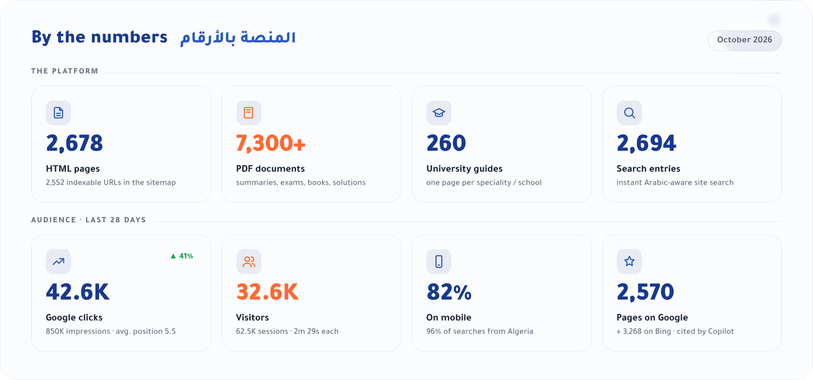
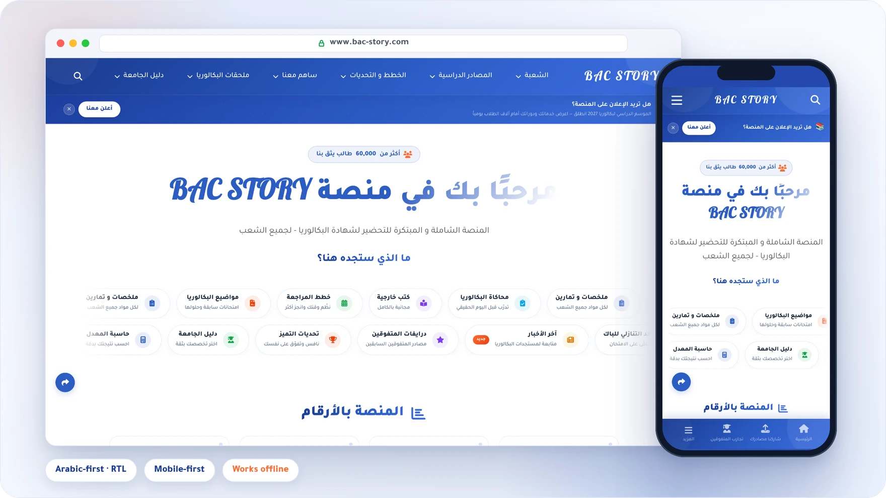
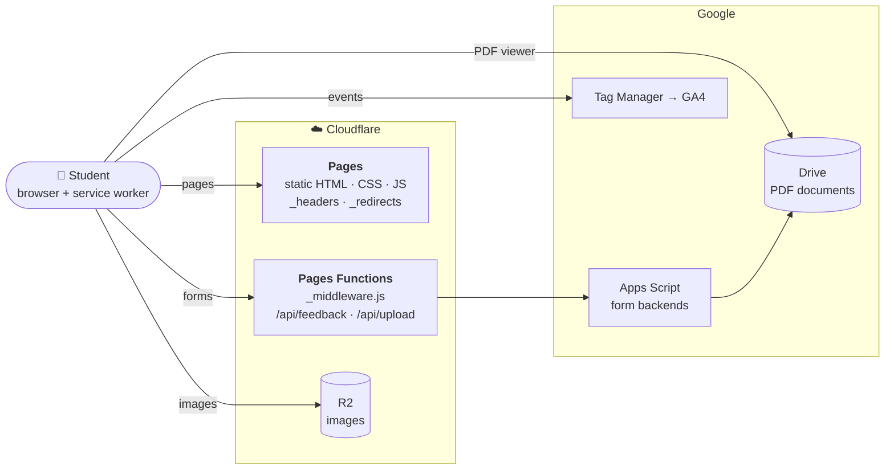

<div align="center">

<a href="https://www.bac-story.com">
  
</a>

<br>

[](https://www.bac-story.com)
[](https://pages.cloudflare.com)
[](#-performance--offline)
[](https://t.me/islembacdz)

**Summaries · past exams with solutions · books · revision plans · BAC simulation · grade calculators · university guide**<br>
for all six streams of the Algerian Baccalaureate, in Arabic, free, on any phone.

[**Visit the site**](https://www.bac-story.com) &nbsp;·&nbsp;
[Features](#-features) &nbsp;·&nbsp;
[Architecture](#-architecture) &nbsp;·&nbsp;
[SEO](#-seo--ai-discoverability) &nbsp;·&nbsp;
[Analytics](#-analytics--monitoring) &nbsp;·&nbsp;
[Develop](#-development)

</div>

<br>



<br>

## ✦ Overview

**BAC STORY** (باك ستوري) is an Arabic-first study platform for students preparing the Algerian
Baccalaureate. It puts everything a student needs in one place, organised by stream
(شعبة) and subject, and it costs nothing to use.

It is a **hand-built static site**: plain HTML, CSS and JavaScript, no framework and no build step.
It is served from **Cloudflare's edge**, the study documents are streamed from **Google Drive**,
the images come from **Cloudflare R2**, and a few **Pages Functions** handle the forms.
The result is fast on a cheap phone and a mobile connection, and it keeps working offline.

<div align="center">
  
</div>

<br>

## ✦ Features

<table>
<tr>
<td width="50%" valign="top">

### 📚 Study resources
Summaries, exercises, mind maps and revision packs for every subject of every stream,
with a built-in PDF viewer and one-tap download.<br>
<sub>`/resources/{math,sci,tech,ge,le,lp}` · 1,240+ pages</sub>

### 📝 BAC exams archive
Official BAC 2024, 2025 and 2026 papers with solutions, the channel's own trial exams,
older archives and monthly *excellence topics* (مواضيع التميز) with a file switcher.<br>
<sub>`/topics` · `/bac-2026` · 700+ pages</sub>

### 📖 Books
External books (Bournane, Oqba Ibn Nafi and others) per stream and subject.<br>
<sub>`/resources/books` · `/oqba` · 390 pages</sub>

### 🧭 University guide
260 speciality and school guides (*grandes écoles*, ENS, medicine, paramedical…),
admission averages and the orientation process.<br>
<sub>`/university` · `/orientation`</sub>

</td>
<td width="50%" valign="top">

### 🧪 BAC simulation
A timed exam room with the official duration for each subject and stream,
a pool of real and trial papers, focus mode and a solution viewer.<br>
<sub>`/simulation`</sub>

### 🧮 Tools
- **Grade calculator** for every stream, with the official coefficients and a shareable result
- **Weighted average calculator** for 6 university fields
- **Countdown** to the BAC exam
- **Official answer sheets** to practise on<br>
<sub>`/tools`</sub>

### 🗓️ Plans and challenges
Monthly excellence plans, per-subject plans and revision challenges.<br>
<sub>`/plans`</sub>

### 🤝 Community
Stories from top students (تجارب المتفوقين), the graduation honours page,
resource sharing (files upload straight to Drive) and a feedback form.<br>
<sub>`/experiences` · `/contribute` · `/feedback`</sub>

</td>
</tr>
</table>

> [!NOTE]
> Every stream is covered: **Mathematics, Experimental Sciences, Technical Mathematics, Management & Economics,
> Foreign Languages, and Literature & Philosophy** (in the code: `math`, `sci`, `tech`, `ge`, `le`, `lp`).

<br>

## ✦ Architecture



| Layer | What it does |
|---|---|
| **Static pages** | Every page is a real `.html` file. Cloudflare Pages serves `page.html` as the clean URL `/page`. |
| **Shared components** | `components/shared.js` injects the navbar, footer and search box into each page, runs the search engine, the page loader, the popups and the share button. |
| **Documents** | PDFs live in Google Drive and open in an embedded viewer, with a direct download button. Pages with several files use a switcher instead of one page per file. |
| **Images** | Served from a Cloudflare R2 bucket. |
| **Forms** | `functions/api/feedback.js` and `functions/api/upload.js` proxy to Google Apps Script. Uploads go to Drive in resumable chunks, through the function, to avoid CORS limits. |
| **Edge rules** | `functions/_middleware.js` sends the old `pages.dev` address to `www`, hides internal files, and answers `410 Gone` for removed sections. |

> [!IMPORTANT]
> Pages Functions only run for the paths listed in **`_routes.json`** (the API, guarded files, removed URLs).
> Everything else is served as a static file. This keeps the site inside the free plan's daily
> Functions quota. Add a path there only if code must run for it.

<br>

## ✦ Project structure

```text
.
├── index.html, about.html, …          21 top-level pages
├── resources/                         study resources per stream, plus books/
├── topics/                            BAC 2024–2025, excellence topics, channel exams, archives
├── bac-2026/                          BAC 2026 papers and solutions per stream
├── university/                        university guide, speciality/ pages (260)
├── tools/                             calculator/, weighted-calc/, countdown, exam-sheet/
├── plans/  oqba/                      revision plans · Oqba Ibn Nafi packs
│
├── components/
│   ├── shared.js                      component loader, search engine, popups, share, loader
│   ├── navbar.html  footer.html  search.html
│   └── calculator.js                  grade calculator logic
├── style.css                          design system (colours, radii, shadows, components)
├── script.js  simulation.js  bac-2026.js  ads-config.js
│
├── functions/
│   ├── _middleware.js                 redirects, blocked files, 410 Gone
│   └── api/  feedback.js  upload.js   form backends (proxy to Apps Script)
├── _headers                           cache and security headers
├── _redirects                         330+ redirects (old URLs, /tg/ links)
├── _routes.json                       which paths run Functions
│
├── sitemap.xml  robots.txt            search engines
├── llms.txt  llms-full.txt            AI assistants (llmstxt.org)
├── search-index.json                  data for the site search
├── manifest.json  sw.js               installable app and offline cache
├── app-icon-*.png                     installed-app icons: rounded corners (any) + full-bleed Android versions (maskable)
├── fonts/fa/                          the site's own Font Awesome (only the icons it uses)
├── fonts/tajawal/  fonts/pattaya/     the text fonts (Google Fonts v12 files, OFL licences inside)
├── fonts/amiri/  fonts/cairo/        calculator fonts (+ fonts/amiri-cairo.css), OFL licences inside
├── images/flags/                     the country flags used on the language pages
└── scripts/generate-sitemap.py        rebuilds sitemap.xml from the real pages
    scripts/build-fa-subset.py         rebuilds fonts/fa/ from the icons the pages use
    scripts/stamp-versions.py          sets every ?v= to the linked file's content hash
    .githooks/pre-commit               refuses a commit with stale ?v= links
```

<br>

## ✦ Design system

| Element | Choice |
|---|---|
| **Colours** | Primary blue `#2C5CC3` (deep `#1A3A8F`) · accent orange `#FF6B35` · success `#28A745` · text `#212529` |
| **Type** | **Tajawal** for all Arabic UI · **Pattaya** for the *BAC STORY* wordmark · Font Awesome 6 icons. All served from `fonts/` (declared at the top of `style.css`), not Google Fonts; the calculator pages also use **Amiri** and **Cairo** from `fonts/amiri-cairo.css`. Tajawal comes in 400/500/700/900: `font-weight: 800` is drawn with the 900 face on purpose (as it always was); only `simulation.html` and `experiences.html` load a real 800. |
| **Shape** | Rounded cards and pills (radius 8–18 px, pills 999 px), soft blue shadows, gradient hero blocks |
| **Layout** | Right-to-left, mobile first, with a bottom tab bar on phones |

All tokens are CSS variables at the top of `style.css` (`--primary-color`, `--secondary-color`, `--radius-*`, `--shadow-*`).

<br>

## ✦ SEO & AI discoverability

<details open>
<summary><b>What is in place</b></summary>
<br>

| Area | How it works |
|---|---|
| **Sitemap** | `scripts/generate-sitemap.py` lists only real, indexable pages whose canonical points to themselves; `lastmod` comes from git. |
| **Canonical URLs** | Identical files published under several streams point to one canonical copy (the one Google already chose), so search engines don't see duplicates. |
| **Structured data** | JSON-LD on every page: `EducationalOrganization`, `BreadcrumbList`, `FAQPage`, `LearningResource`, `Book`, `CollectionPage`… validated against the schema.org vocabulary. |
| **Real links** | Navigation uses real `<a href>` links styled as buttons, so crawlers can follow them (the speciality grid is next, see the roadmap). |
| **robots.txt** | *Answers yes, training no*: search engines and AI assistants are welcome; crawlers that only collect AI training data are blocked. `/api/` is not crawled. |
| **llms.txt** | `llms.txt` (short index) and `llms-full.txt` (full guide) describe the site for AI assistants. |
| **Redirects** | Renamed pages keep their traffic through `301` redirects; removed sections answer `410 Gone`. |
| **Telegram links** | Share `bac-story.com/tg/<page>`: it redirects to `<page>` with UTM tags, so Telegram visits show up in Analytics. |

</details>

> [!WARNING]
> **Rules for `_redirects`**: exact paths go **first**, rules with `*` or `:placeholders` go in the section at the end.
> Cloudflare counts every rule after the first wildcard as dynamic, allows **100** of them, and silently
> skips the rest.

<br>

## ✦ Analytics & monitoring

| Tool | Used for |
|---|---|
| **Google Search Console** | Domain property `bac-story.com`: clicks, queries, indexing, duplicates, 404s |
| **Google Analytics 4** | Through Google Tag Manager (`GTM-T5H3TNJ4`): visitors, pages, sources, events |
| **Bing Webmaster Tools** | Bing indexing, sitemap, and *AI Performance* (citations in Copilot answers) |
| **Cloudflare** | Requests, cache, security events, Functions usage |
| **Ahrefs** (free) | Site audit and backlink checks |

**Custom events** sent to the `dataLayer`:

| Event | Fired when | Source |
|---|---|---|
| `page_view` | a section opens inside a multi-section page | `script.js`, `shared.js` |
| `calculator_result` | the grade calculator shows a result (with `bac_stream`) | `components/calculator.js` |
| `exam_completed` | a BAC simulation is finished (subject, stream, time spent) | `simulation.js` |
| `feedback_sent` | the feedback form is sent | `feedback.html` |
| `telegram_click` | a Telegram link is clicked | GTM trigger |

<br>

## ✦ Performance & offline

| Asset | Browser cache |
|---|---|
| Site images (`png`, `jpg`, `webp`, `svg`…) | 1 year, `immutable` |
| Font Awesome (`fonts/fa/`) | 1 year, `immutable` (versioned by `build-fa-subset.py`) |
| CSS, JS, navbar/footer/search, `search-index.json` | 1 week (every link carries `?v=<content hash>`) |
| HTML pages | always revalidated, so new content shows at once |
| `sw.js` | never cached |

The **service worker** (`sw.js`) never touches page navigations. It caches CSS, JS, images and
components the first time a page uses them, serves them from that cache afterwards and refreshes
them in the background. That makes repeat visits instant and helps on a weak connection.

> [!IMPORTANT]
> After editing any CSS, JS, `navbar.html` / `footer.html` / `search.html` or `search-index.json`,
> run **`python3 scripts/stamp-versions.py`** before committing. It sets every `?v=` to the file's
> content hash, so visitors get the new version at once even though browsers keep these files for
> a week. Editing a component or the search data rewrites the `shared.js` link on every page: a
> diff that touches all pages is normal then.
>
> - **Safety net:** run `git config core.hooksPath .githooks` once in your clone and a commit with
>   stale links is refused. Every push is also checked by GitHub (*Actions → Check ?v= links*;
>   GitHub emails you if it fails).
> - **If an old file is stuck in visitors' browsers:** re-stamp and push (a new hash is a new
>   address). Changing `_headers` back does not remove copies browsers already keep.
> - **Going to 1-year caching later:** set the Cloudflare Pages build command to
>   `python3 scripts/stamp-versions.py --check` (a stale link then fails the deploy), then change
>   the 1-week rules in `_headers` to `public, max-age=31536000, immutable`.

<br>

## ✦ Development

**Run locally** (the same engine as production, with `_headers`, `_redirects` and Functions):

```bash
npx wrangler pages dev .
# → http://localhost:8788
```

**Deploy:** push to the production branch **`(root)`**. Cloudflare Pages builds and publishes it automatically.

**Rebuild the sitemap** after adding or removing pages:

```bash
python scripts/generate-sitemap.py
```

**Rebuild the icons** after using a Font Awesome icon the site never used before (a new `fa-…` class).
The site serves only the icons it uses (~40 KB instead of ~300 KB from cdnjs). If you forget, the
new icon still shows (the page loads the full Font Awesome and names the icon in the console), it is just slower there.

```bash
pip install fonttools brotli
python scripts/build-fa-subset.py
```

<details>
<summary><b>Checklist for a new page</b></summary>
<br>

1. Copy a sibling page so the `<head>` (fonts, GTM, `shared.js`, styles) stays identical.
2. Give it its own `<title>`, `<meta name="description">`, `<link rel="canonical">`, `og:url` and JSON-LD.
3. Link to it from its parent page with a real `<a href>` (not `onclick`).
4. Add it to `search-index.json` so the site search finds it.
5. Run `scripts/generate-sitemap.py`, and add it to `llms.txt` if it is a main page.
6. If it replaces an old URL, add a `301` in `_redirects` (exact rules above the wildcard section).

</details>

<details>
<summary><b>Maintaining this README</b></summary>
<br>

The banner, the numbers card and the preview are HTML files in `.github/assets/src/`, rendered with the
site's real fonts:

1. Edit `banner.html`, `stats.html` or `preview.html` (refresh the numbers from Search Console and Analytics).
2. For `preview.html`, take two screenshots of the homepage at 2× into `src/shots/`: `desktop.png` (1440×900) and `mobile.png` (390×844).
3. Render the `.banner`, `.card` or `.stage` element at 2× (for example with Playwright), resize to 1760 px wide, and save it as
   `banner.webp`, `stats.png` and `preview.webp` in `.github/assets/`.

</details>

<br>

## ✦ Roadmap

- [ ] Unique titles and descriptions for the 260 speciality pages, plus real links from the speciality grid
- [ ] Sharper titles and snippets for the calculator and the countdown, which get many impressions but few clicks
- [ ] Turn on IndexNow (Cloudflare *Crawler Hints*) so Bing and others see changes at once
- [ ] Check `page_view` counting on multi-section pages (`/university` shows about 37 views per visitor)
- [ ] Earn real backlinks from education sites and partners
- [ ] Compress the heaviest university photos

<br>

## ✦ Contact

<table>
<tr>
<td>

**Redouane Mohamed Islem** — founder and developer

📢 Telegram channel: [@islembacdz](https://t.me/islembacdz) &nbsp;·&nbsp;
💬 Contact: [@bacstorycontact](https://t.me/bacstorycontact) &nbsp;·&nbsp;
✉️ [contact@bac-story.com](mailto:contact@bac-story.com)<br>
📸 [Instagram](https://www.instagram.com/bacstory.platform) &nbsp;·&nbsp;
🎵 [TikTok](https://www.tiktok.com/@bacstory.platform) &nbsp;·&nbsp;
📘 [Facebook](https://www.facebook.com/share/1EMz54rJGz/)

</td>
</tr>
</table>

<div align="center">
<br>

<br>
<sub><b>BAC STORY</b> · © 2026 · Study documents remain the property of their authors.</sub>
<br>
<sub dir="rtl">منصة التميز في البكالوريا</sub>
</div>
